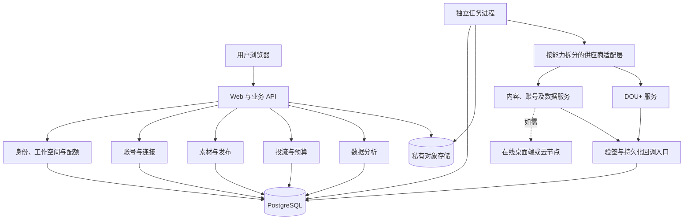
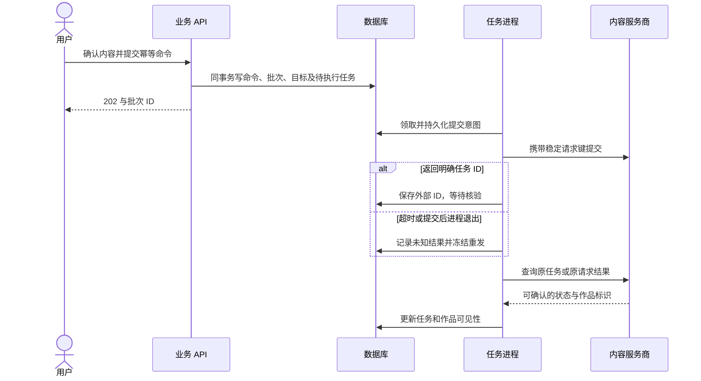

# 架构分析与决策

分析日期：2026-10-27。依据：[README](../README.md)、[TODO](../TODO.md)。本文定义拟实现的架构，不表示应用、数据库或供应商集成已经完成。场景证据见 [SCENARIO_VALIDATION](SCENARIO_VALIDATION.md)，外部能力见 [PROVIDER_CAPABILITIES](PROVIDER_CAPABILITIES.md)。

落地更新：Alpha 0.01 已实现 Web、业务服务和独立 worker，本地默认采用 SQLite，另提供 PostgreSQL 访问路径；本文其余内容仍是目标架构，不应视为全部完成。当前实现与验证范围见 [Alpha 0.01](ALPHA_0.01.md)。

## 1. 结论与边界

采用模块化单体业务后端、独立后台任务进程、PostgreSQL 和私有对象存储。Web 负责操作与展示，后台任务负责发布、投放、数据同步和结果核验。暂不拆微服务，不把浏览器页面存活作为执行前提。

首期任务直接持久化在 PostgreSQL，任务进程领取；业务与任务记录在同一事务提交，避免数据库成功而任务丢失。以后确有吞吐需要再增加独立消息队列，数据库仍是业务事实来源。PostgreSQL 的行锁可保护配额与预算，`SKIP LOCKED` 可用于多消费者领取队列表；它不用于财务统计的一致性读取。[行锁文档](https://www.postgresql.org/docs/current/explicit-locking.html)、[队列领取语义](https://www.postgresql.org/docs/current/sql-select.html)。

推荐工程基线为 TypeScript、Next.js Web/API、独立 Node.js 任务进程、PostgreSQL 和私有对象存储，理由与部署边界见下文。具体版本、迁移工具及托管产品在工程初始化时锁定；这是一项架构建议，尚未创建应用或安装依赖。此次 Python 脚本只是可执行设计模型，不决定应用使用 Python。

必须保留的边界：

- 产品登录、抖音账号授权、供应商连接和投放账户授权是不同对象。
- 账号可读取、可发布、可分析、可投流分别判定；未知能力默认不执行真实写操作。
- 接入商可能要求跳转绑定或在线执行节点，纯 Web 操作界面不等于后台无需节点。
- 内容提交、公开可见、具备投放资格、投流订单创建、付款和起投分别确认。
- 已发布视频不能因订单失败自动重发；换供应商也不能作为写操作超时的自动补救。
- 系统控制自身发起的授权额度，不承诺拦截用户从抖音或其他系统发起的花费。

## 2. 部署与模块



| 模块 | 负责 | 不负责 |
| --- | --- | --- |
| Identity / Workspace | 登录、成员角色、租户边界 | 抖音账号密码 |
| Entitlements | 套餐快照、账号和存储等配额 | 广告余额或投放资金 |
| Connections / Accounts | 供应商凭据、授权版本、能力与节点状态 | 假设全部服务商账号 ID 通用 |
| Assets / Publishing | 素材版本、批次、账号任务、作品回收 | 确保平台审核通过 |
| Promotion / Budget | 确认单、额度占用、订单、核验与对账 | 自建充值钱包、假定付款即起投 |
| Analytics | 指标字典、快照、趋势及比较 | 用估算值补齐接口缺失指标 |
| Jobs / Inbox / Audit | 持久任务、回调去重、核验和操作日志 | 保证外部系统 exactly-once |

模块共享数据库但通过业务服务调用，禁止分析模块直接修改订单。API 与任务进程可先共用仓库和代码包、分别部署与扩容；供应商 SDK 仅存在于后端适配层。

### 推荐技术基线与取舍

| 层级 | 推荐基线 | 原因与约束 |
| --- | --- | --- |
| Web 与短请求 API | TypeScript + Next.js App Router / Route Handlers | 一个项目维护页面和接口；接口只校验、持久化并返回，不承担长时间上传与投放执行 |
| 业务规则 | 与框架无关的 TypeScript 服务模块 | Web 与 worker 复用归属、状态和预算规则，避免页面路由直接写供应商调用 |
| 后台执行 | 独立 Node.js 进程 | 有独立生命周期，可持续领取、核验和同步，不依赖页面关闭后的请求钩子 |
| 数据与任务 | PostgreSQL，优先显式事务和版本化 SQL 迁移 | 配额、预算、命令和任务在同一事实来源；事务通过同一数据库连接完成 |
| 数据访问 | 优先 node-postgres，封装参数化查询与事务单元 | 让锁与事务范围可审查；若选 ORM，仍需保留受控 SQL 与同一事务上下文 |
| 文件 | 私有对象存储，通过授权上传和访问 | 素材权限与工作空间绑定；需要本地文件的供应商另设节点下发步骤 |
| 页面更新 | 查询任务状态，后续按需要增加推送 | 首期不引入实时消息基础设施，也不以断开浏览器判断任务取消 |

Next.js 提供 HTTP Route Handlers 和自托管方式，但这不提供外部写操作的可靠执行保证；关键任务仍由本设计的持久 worker 完成。[Route Handlers](https://nextjs.org/docs/app/getting-started/route-handlers)、[自托管说明](https://nextjs.org/docs/app/guides/self-hosting)。node-postgres 的事务必须在同一个 client 上执行，不能用多个池查询假装处于一个事务。[事务文档](https://node-postgres.com/features/transactions)。

方案比较：独立前端加独立 API 框架可行，但当前没有独立团队或分开发版要求，暂不增加部署边界；微服务会增加跨库一致性和运营成本，暂不采用。若最终供应商的 SDK 或部署限制要求其他语言，只替换适配器或 API 实现，不改变状态与预算契约。

拟定代码布局如下，仅为后续工程规划：

```text
apps/web/          页面、登录与 HTTP 入口
apps/worker/       持久任务领取、调用、查询与恢复
packages/domain/  账号、发布、投流、配额及指标规则
packages/db/      迁移、参数化查询与事务
packages/providers/  按能力划分的供应商适配器
docs/             架构、接入证据与验证报告
validation/       当前离线参考模型；不作为生产应用代码导入
```

首期部署 Web 和 worker 两个应用进程，数据库与存储独立配置；供应商桌面端或云执行节点属于另外的运行依赖。即使后续 Web 部署在短生命周期环境，worker 也必须有持久运行与恢复保障。

## 3. 数据模型与约束

所有业务实体使用内部 ID。除全局用户外，业务记录携带 `workspace_id`；外键使用包含工作空间的复合约束，防止跨租户引用。服务端从登录成员关系确定权限，不信任请求中的工作空间 ID。

| 实体 | 关键字段与约束 |
| --- | --- |
| workspace / membership | 成员角色、展示时区、默认币种；修改预算时区不得改变既有预算桶 |
| entitlement / usage | 套餐版本、上限、使用量；并发绑定时锁定工作空间配额行 |
| provider_connection | workspace、provider、supplier_user、凭据引用、授权版本、状态；密钥加密保存 |
| account / account_binding | 内部账号、连接、应用范围、external_id、授权代次；外部唯一键必须包含连接和命名空间 |
| capability_snapshot | 连接、账号、操作、supported/unsupported/manual/unknown、时间、证据、版本 |
| executor | 连接、节点 ID、状态及权限；供应商不支持节点选择时不生成虚构参数 |
| asset / asset_version | workspace、内容摘要、对象键、所有者、不可变版本、处理状态 |
| publish_batch / publish_target | 确认快照、素材版本、账号、授权代次、外部请求键、状态、作品映射 |
| work / work_binding | 内部作品、账号、平台可见性、连接内作品 ID、投放资格证据 |
| promotion_batch / promotion_order | 用户确认、作品、投放连接、资金账户、预算、订单/支付/投放分别存储的状态 |
| budget_policy / reservation | 策略版本、币种、确认日、占用、已结算实耗、结算证据及修订号 |
| command / durable_job | workspace、操作、幂等键、参数摘要、任务、领取代次、租约、执行阶段 |
| webhook_inbox | 连接、事件 ID、业务 ID、载荷摘要、验证结果、接收时间、处理状态 |
| metric_definition / observation | 指标、对象、来源、统计口径、区间、单位、采样时间、修订与缺失原因 |
| audit_event | 操作者、对象、确认快照、前后状态、关联请求；不保存明文令牌 |

关键唯一约束：

1. `command(workspace_id, operation, idempotency_key)`；同键同摘要返回原批次，同键不同摘要返回冲突。
2. `publish_target(workspace_id, account_id, asset_version_id, intent_revision)`；新请求键不能绕过未决发布。重复发布需独立意图及用户明确确认，不作为默认批量行为。
3. `promotion_order(connection_id, external_order_id)` 与不可变内部命令关联；未获外部 ID 时也必须保留原请求键。
4. `webhook_inbox(connection_id, event_id)`；无稳定事件 ID 时保存载荷摘要并查询业务现状，不能只按静态 webhook 配置 ID 去重。
5. 账号额度和预算检查与记录创建处于同一事务；任务领取用租约和代次校验，过期进程不能覆盖新执行者的结果。

同一抖音账号跨供应商的关联必须有官方或供应商可验证标识。昵称、头像或用户手填字符串不足以证明账号一致；映射不明确时禁止投放。首期同一连接范围的同一账号只允许一个工作空间占用；不同连接之间无法证明身份时，不宣称具备全局去重。

## 4. 内部 API 契约草案

下面是本产品拟定义的路由，不是供应商接口，也尚未实现。写操作均校验角色、工作空间、配额、能力、当前授权和参数版本。

| 方法与资源 | 语义 |
| --- | --- |
| GET /api/accounts | 当前工作空间可访问的账号、状态与能力 |
| POST /api/connections/authorization-sessions | 创建短时、单次使用的授权会话，返回可用授权方式 |
| POST /api/accounts/import | 同步当前连接拥有且可确认归属的账号；不能按任意外部 ID 导入他人账号 |
| POST /api/publish-previews | 只读检查，返回内容、账号、限制和快照摘要 |
| POST /api/publish-batches | 携带幂等键与确认摘要，202 返回批次；校验失败不创建半批任务 |
| GET /api/publish-batches/:id | 每个账号的状态、错误及作品链接 |
| POST /api/promotion-previews | 检查作品映射、目标、资金账户和预算，生成有期限的确认摘要 |
| POST /api/promotion-batches | 用户确认后原子占用预算并创建任务；不接受前端声明“已付款” |
| POST /api/promotion-orders/:id/stop | 提交停止请求；收到确认前仍保留可能的消耗额度 |
| POST /api/promotion-orders/:id/append | 独立确认与幂等命令，重新检查额度与供应商追加语义 |
| GET /api/analytics | 带来源、区间、缺失与延迟元数据的指标 |
| POST /api/webhooks/:connectionPublicId | 按供应商约定验证原始请求体，入库后异步处理 |

预览摘要包含规范化目标列表、素材版本、参数、资金账户、额度策略和授权版本。任一项改变、过期或执行资格变化，都必须重新校验；实际写操作不得只依赖预览时的检查。读取历史幂等结果仍须校验当前用户对该工作空间的访问权限。

## 5. 账号绑定与配额

1. 用户登录产品并进入工作空间；绑定仅由具备管理权限的成员发起。
2. 本地原子占用一个短时绑定名额，创建含随机 state 的授权会话；state 绑定用户、工作空间、连接和到期时间。
3. 跳转供应商授权，或展示必须在供应商界面操作的步骤。无绑定 API 时只能如实标注“前往第三方绑定”。
4. 回调验证一次性 state、服务端换取凭据并查询归属；重复回调只返回已有绑定。多个外部账号导入必须逐个计算额度。
5. 绑定成功转为正式占用；取消或超时释放临时名额，晚到回调重新检查额度，不能借此超额。
6. 解除连接立即递增授权代次并停止排队中的新写操作；进行中或可能已提交的写操作进入核验，不当作已撤销。

会员降级不删除既有账号和历史订单。超额账号只读，阻止新增绑定和新批次；在途订单继续对账。解绑和彻底删除分开：解除授权后按供应商契约处理数据保留、删除和审计，不能预设无限期保留平台数据。

## 6. 发布流程与状态



账号级任务状态：`QUEUED → SUBMITTING → ACCEPTED → VERIFYING → SUCCEEDED`。执行前资格不满足进入 `BLOCKED`，确认未提交或明确拒绝进入 `FAILED_CONFIRMED`；网络超时、发送后退出或缺失结果进入 `UNKNOWN → VERIFYING`。

`SUCCEEDED` 仅代表已确认发表结果，作品另有 `public/private/restricted/removed/unknown` 可见性。后续下架更新作品状态，不回退成“从未发布”。抖音官方说明创建后还有审核，因此返回作品标识不能直接推断已公开。[创建视频文档](https://partner.open-douyin.com/docs/resource/zh-CN/dop/develop/openapi/video-management/douyin/create-video/video-create)。

批次提交时本地检查失败则整批拒绝，不调用供应商；入队后账号状态变化可以导致部分成功。用户能针对明确未提交的失败项重试，成功项和未知项不能随整批重发。

对 `SUBMITTING` 阶段过期的任务，恢复时按未知结果处理。供应商不支持持久幂等或按请求查询时，无法从本地单方面保证外部只执行一次；应停在人工核验，不跨供应商重发。供应商幂等键失效后也不自动换键。

领取任务时在短事务内更新租约、代次和提交意图，提交事务后才访问网络，禁止持有数据库行锁等待供应商。外部调用失败不等于回滚了外部副作用；确认时校验当前代次并写入证据，恢复进程负责核验未知结果。不得用“重新投递队列消息”直接代表安全重试写接口。

## 7. DOU+ 投流与预算

### 7.1 四个状态维度

| 维度 | 示例状态 | 不能做的推断 |
| --- | --- | --- |
| 创建 | queued / submitting / created / unknown / rejected | created 不代表已付款 |
| 支付 | not_required / unpaid / paying / paid / unknown / failed | paid 不代表审核通过 |
| 审核与投放 | auditing / waiting / delivering / paused / stop_requested / ended / rejected / unknown | stop_requested 不代表消耗已经结束 |
| 结算 | provisional / final / correction_required | ended 不代表报表实耗已最终稳定 |

官方 DOU+ 订单查询文档列出了未付款、审核中、投放中和结束等不同状态，预算单位是分；适配层必须显式映射，未知枚举保留原值并暂停自动决策。[官方订单查询](https://open.oceanengine.com/labels/7/docs/1771736421276680)。

### 7.2 预算含义

金额使用整数分和明确币种，禁止浮点金额、负数、零和布尔值作为金额。用户确认单覆盖作品、每单金额、资金账户、时长和目标，不能以稍后修改模板的参数付款。

首期明确提供两种产品侧额度：

1. **每日确认额度**：按工作空间时区、用户确认当日计入。`该日未结算预算 + 该日已最终结算实耗 + 新预算 ≤ 当日上限`。它不是平台当天实际消耗上限。
2. **在途风险额度**：所有日期尚未最终结算订单的完整预算之和加新预算，不超过在途上限。跨午夜不释放旧订单，避免每天重置造成风险无限叠加。

另校验单单和单批上限，采用固定顺序行锁，在同一事务检查全部桶、写占用及任务；预检或后续步骤失败必须整体回滚。预算配置更新使用版本校验，降额不取消旧订单，但阻止不满足新上限的新授权。

停止申请、审核拒绝通知、支付结果不明或外部订单暂时查不到，都不能单独证明可释放预算。只有得到可核验的不会继续执行或最终结算证据后，才释放未花费部分。实耗更正保留修订历史；若超出原预算，记录真实值、冻结新投放并告警，不能截断报表数值以假装未超额。

预算占用只是产品侧控制记录，不是扣款或钱包余额。用户在其他入口投放、供应商延迟和外部超支不受本地事务约束；应显示来源与更新时间并定期对账。跨多资金账户可增加账户维度上限，不能用一个余额快照保证付款成功。

### 7.3 一键下单与未知结果

确认后预留全部预算，逐作品创建命令；任务执行前复查授权、映射、资格和节点。下单与付款分别有稳定幂等键及外部状态。明确无副作用的失败可按有界退避重试；连接中断、5xx 或无记录返回通常不足以证明未执行，应进入核验。

首期不承诺“发布后无人值守自动花钱”：发布完成后展示实际作品再确认投流。后续发布与投流联动需有用户事先确认的完整规则、总上限与明确资格检查，单独评审。

## 8. 数据分析与回调

- 每个指标保存定义、来源、对象、时间区间、单位、聚合方式和修订号。仅在定义兼容时比较；累计值不按天相加，累计修正或下跌不自动归因成负新增。
- 作品总播放与订单归因播放可能重叠，不直接相加，也不默认相减得到自然播放。
- 没有数据、没有权限、延迟、同步失败和真实 0 分别展示。完播率、转化率等比率不能对账号简单平均，缺少分母时不计算汇总。
- 无版本的乱序回调只作为查询触发信号；有可核验的版本或权威查询结果才更新业务状态。接收回调不等于确认真实业务成功。
- 验证签名和时间窗口、持久化 inbox 后快速应答；重复事件只处理一次，恢复任务补偿丢失通知。不同连接不得共用事件去重空间。
- 在途写操作撤销授权后仍尽可能通过原连接查询；若无法查询，保留未决记录与预算，明确提示核验。

## 9. 安全、运行与容量验证

首期至少设置 owner、operator、viewer：owner 管理连接及预算策略，operator 在授权上限内发布和投放，viewer 只读。Web、任务进程、回调和导出四条链路均验证租户边界。密钥轮换不泄露明文；对象存储私有并校验所有权，供应商回传 URL 不作为任意服务端下载地址，防止 SSRF。

试运行使用少量账号；容量估算是待压测假设。例如每个账号每 15 分钟同步一次，每日基础请求约为 `账号数 × 96 × 每次同步实际分页数`，还需加作品与订单查询。不能把“40+ 平台支持”当作吞吐或抖音额度。应先取得实际限流、分页和成本，再确定调度与会员额度。

上线前验证数据库并发、事务回滚、租约回收、数据库恢复、真实回调、对象存储和供应商幂等。监控未知任务年龄、失败率、节点离线、授权过期、数据延迟、在途预算和账实差异。任务领取失败不会丢掉数据库中的任务，但跨系统的副作用仍须核验。

## 10. 架构决策与放行

| 决策 | 选择 | 重新评估触发条件 |
| --- | --- | --- |
| 服务划分 | 模块化单体 + 独立任务进程 | 测得独立扩容或发布隔离需求 |
| 初期任务基础设施 | PostgreSQL 持久任务与事务 | 真实吞吐、延迟或数据库负载不达标，再加外部队列 |
| 租户模型 | 工作空间从首日入模，角色明确 | 企业隔离要求超过共享库策略 |
| 接入模式 | 按能力选择连接，未知默认阻止真实写入 | 供应商联调拿到证据再逐项开放 |
| 自动续投 | MVP 不开启 | 具备可靠效果数据、控制接口和用户确认规则 |
| 商业化 | 配额先建模，暂不实现收费 | 接入许可、实际成本和试运行闭环通过 |

**允许继续：** 页面原型、数据库设计、持久任务、模拟适配器和模型场景验证。

**尚未放行：** 真实多用户商业接入、真实全自动 DOU+、商品或团购挂载。需要供应商许可、账号及作品映射、指标权限和真实联调证据；详见能力矩阵。模型测试通过不能替代这些条件。
